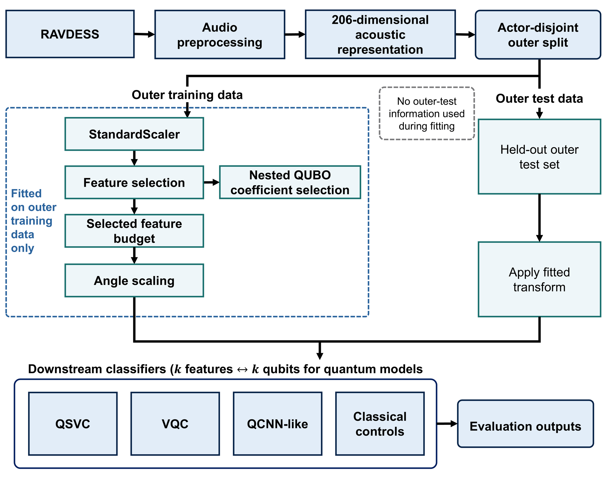
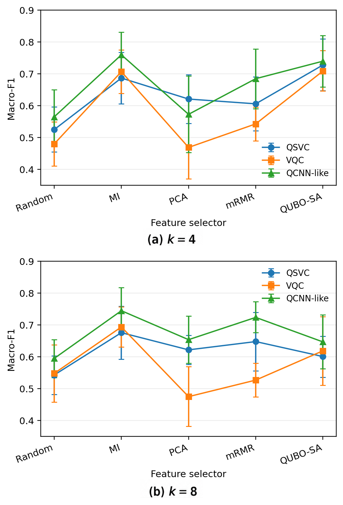

# QSER: Resource-Aware Quantum Downstream Classification for Speech Emotion Recognition

[](https://www.pd-cat.org/2026/)


**Paper:** *Resource-Aware Quantum Downstream Classification for Speech Emotion Recognition under Compact Feature Budgets*

**Authors:** Minh Ngoc Le · Duy Thanh Huynh · Bao Quoc Tien · Hoang Ngoc Tran  
**Affiliation:** FPT University, Can Tho, Vietnam  
**Venue:** The 27th International Conference on Parallel and Distributed Computing, Applications and Technologies (**PDCAT 2026**)  
**Status:** **Accepted; presentation and proceedings publication pending** (as of November 2026).  
**Conference:** [PDCAT 2026](https://www.pd-cat.org/2026/) · Changsha, China · 4–6 December 2026.

> **Scope of this artifact:** This repository documents the accepted manuscript's methodology, paper-reported result tables, selected original result CSVs, and post-hoc analysis utilities. The supplied project archive **did not contain the original experiment source code or notebooks**. This is therefore **not yet an end-to-end training reproduction package**. See [Reproducibility](docs/REPRODUCIBILITY.md).

## Overview

Quantum classifiers are resource-constrained: choosing `k` acoustic features often determines the number of qubits, circuit width, and simulator cost. This study fixes a 206-dimensional handcrafted acoustic representation and tests how feature selection, classifier architecture, and feature budgets interact under leakage-controlled evaluation. Quantum models are **simulated classically**, not run on quantum hardware.



**Benchmarked approaches:**
- **Quantum:** quantum support vector classifier (QSVC), variational quantum classifier (VQC), and a QCNN-like classifier.
- **Classical matched controls:** SVM-RBF, linear SVM, logistic regression, random forest, and an MLP.
- **Feature selectors:** Random, mutual information (MI), PCA loading, greedy mRMR, and QUBO solved using **classical simulated annealing**.
- **Feature budgets:** `k = 4` and `k = 8` for the main comparisons, with a separate `k = 16` simulator-stress tier.
- **Tasks:** RAVDESS binary calm/happy, eight-class RAVDESS, and matched six-emotion RAVDESS/CMU-MOSEI analyses.

## Key paper-reported results

The table below is reproduced from **Table 3 of the accepted manuscript** (10 actor-disjoint seeds, best selector within each model/budget). Values are mean ± sample standard deviation of Macro-F1.

| Classifier | k = 4 | k = 8 |
|:--|:--:|:--:|
| QSVC | **0.728 ± 0.114** (QUBO-SA) | 0.676 ± 0.116 (MI) |
| VQC | **0.709 ± 0.089** (QUBO-SA) | 0.694 ± 0.088 (MI) |
| QCNN-like | **0.760 ± 0.099** (MI) | 0.745 ± 0.102 (MI) |
| Classical control | **0.848 ± 0.100** (QUBO-SA + RF) | **0.848 ± 0.095** (MI + RF) |



**Interpretation:** Classical matched baselines remain stronger in the reported comparisons. The best selector depends on architecture and feature budget; this study **does not demonstrate quantum predictive advantage**. At k = 8, nested QUBO tuning shows suggestive improvements, but Holm-adjusted `p = 0.0625` does not meet a 0.05 significance threshold. On eight-class RAVDESS, the best quantum Macro-F1 values are `0.278` (k = 4) and `0.279` (k = 8), below matched classical bests `0.354` and `0.353`.

The `k = 16` results are **three-seed stress-tier** observations and should not be presented as ten-seed robustness estimates or hardware-speed measurements.

## Repository structure

```text
.
├── README.md, README_VI.md, CITATION.cff, CITATION.bib
├── figures/                      # Figures corresponding to the accepted manuscript
├── results/
│   ├── paper_tables/             # Reported manuscript Tables 3–6 (manual transcription)
│   └── supplied/                 # Selected original CSV/JSON outputs from the supplied ZIP
├── scripts/                      # Data checks, table display and visualization (not training)
├── tests/                        # Basic artifact integrity tests
├── docs/
│   ├── METHODOLOGY.md
│   ├── DATASETS.md
│   ├── REPRODUCIBILITY.md
│   ├── RESULT_PROVENANCE.md
│   └── RELEASE_CHECKLIST.md
└── paper/                        # Publication status; PDF not redistributed by default
```

## Quick start: analyze the released tables

```bash
python -m venv .venv
# Linux / macOS
source .venv/bin/activate
# Windows PowerShell: .venv\Scripts\Activate.ps1
pip install -r requirements.txt

python scripts/validate_results.py
python scripts/show_summary.py
python scripts/plot_paper_results.py
```

The plot script writes a **derived visualization** to `figures/generated/`. It does not rerun quantum simulations. To understand experimental setup and missing materials, see [Methodology](docs/METHODOLOGY.md) and [Reproducibility](docs/REPRODUCIBILITY.md).

## Data availability and responsible reuse

- [RAVDESS (official Zenodo record)](https://zenodo.org/records/1188976), licensed by its creators under **CC BY-NC-SA 4.0**.
- [CMU-MOSEI (official dataset page)](https://multicomp.cs.cmu.edu/resources/cmu-mosei-dataset/), distributed through the [CMU Multimodal SDK](https://github.com/CMU-MultiComp-Lab/CMU-MultimodalSDK).

The original speech/audio files and derived `.npy` feature caches are **not included**. Retrieve datasets from their respective owners and comply with all terms. See [Datasets](docs/DATASETS.md).

## Citation

The paper has been **accepted but is not yet published**, so **no DOI, publisher volume or page range is claimed**. For now, use the provisional [BibTeX entry](CITATION.bib). After publication, replace it with the official Springer citation and DOI.

## License and publication notice

The authors have not selected a public software license for this research artifact. **No rights beyond those granted by applicable law are implied.** The accepted manuscript PDF and acceptance correspondence are intentionally excluded pending publisher/author permission. Consult all coauthors before making a repository public. See [Release checklist](docs/RELEASE_CHECKLIST.md).
